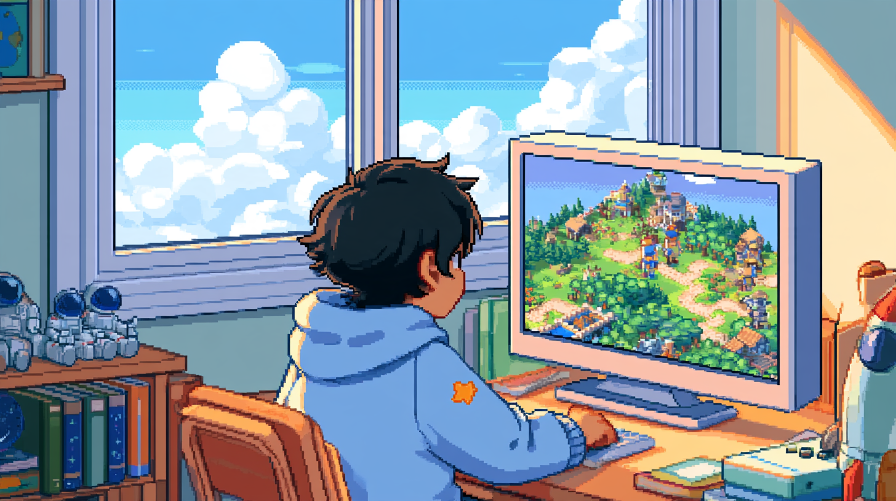
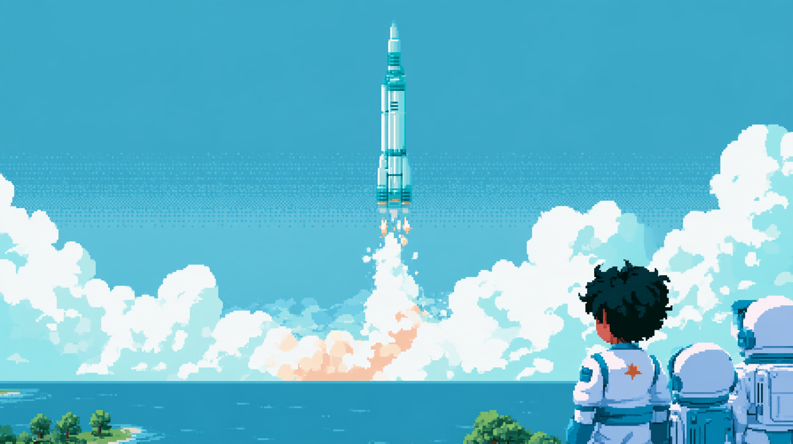
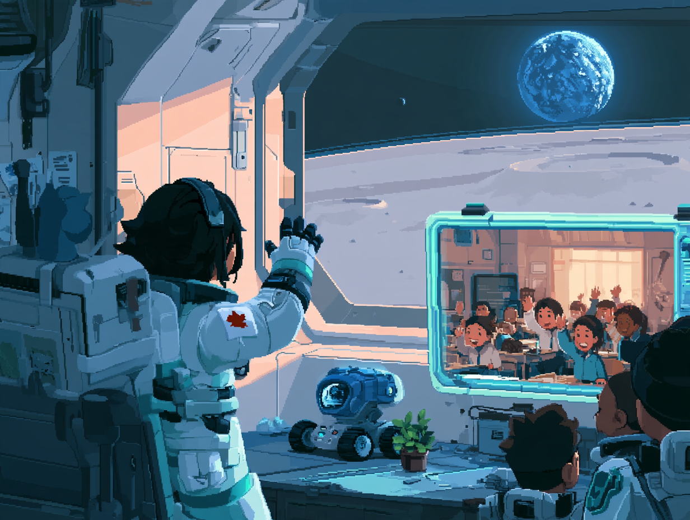
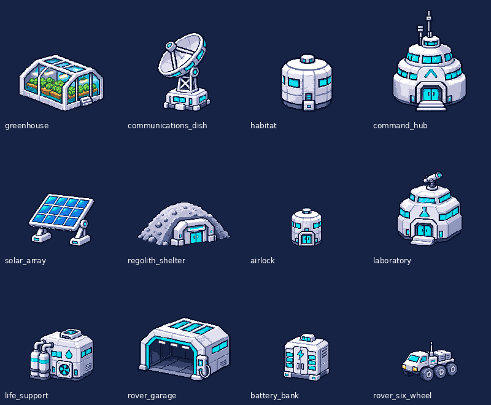
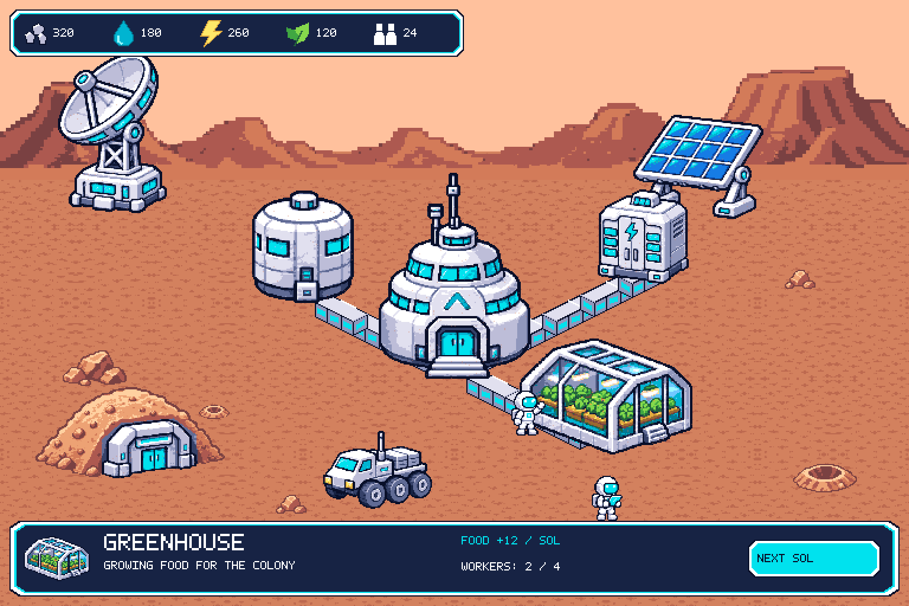
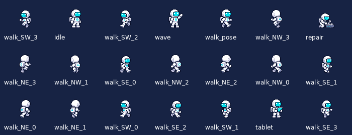
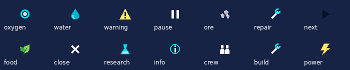

# AI use log — Mapmakers of the Moon

Space Apps 2026, Junior Astronaut Mission Trainer. Kept beside the 25-hour board (`Mapmakers 25-Hour Board.html`).

**This is the merged master log.** It combines three records:

| Tag | Source | What it gave |
|---|---|---|
| **[R]** | Repository evidence (git, file times, hashes, reports) | Facts that can be checked |
| **[X]** | Codex-reconciled log (Nov 14) | Code and doc entries, SHA-256 matches, credit fixes |
| **[G]** | ChatGPT-chat log, `AI_USAGE_LOG.md` (dated Nov 15) | Pre-event planning, UI guide, art brief, asset pack method |
| **[T]** | Team message, Nov 14 | Midjourney prompts, "all art is AI" statement |

Times are America/Toronto. Commit times are checkpoints. File times are copy or export times. Neither is a prompt or generation time.
Anything not recorded is marked **not recorded** or **To confirm**. Test results are quoted from old reports and were not rerun.

> **Team statement (Nov 14): all project-created art is AI-created.**
> This covers image-model art, its derivatives, procedural graphics from AI-written scripts, and code-drawn placeholders.
> Python or Unity rendering is a method, not an image model. Engine, template, package and NASA/CSA data keep their own credits.

---

## 0. Big picture

- **Game = AI-written code + AI-made art + AI-assisted planning.** People gave direction, references and decisions.
- **Three tool families:**
  - ChatGPT: early planning, UI guide, art brief, cutscene prompt text, asset pack images.
  - Claude Code and Codex: code, tests, data, docs.
  - Midjourney: 7 cutscene images.
- **In the build today:** 7 Midjourney cutscenes, a subset of the AstroCiv pack (commit `307fdac`, Nov 14 21:46) and code-drawn icons.
- **Not used yet:** corridors, bitmap font, panels, Laboratory, Command hub, Airlock.
- **Models (team, Nov 14):** Claude Code with Sonnet 5.5 and Opus 5.5. ChatGPT GPT 6.1 Sol and Luna. Midjourney 8.2.
- **Rough size:** about 3 days of planning and art (Nov 9–11), then one long build day on Nov 14. See section 4b.
- **Gaps are small.** Chat exports and Midjourney job IDs are nice to have. See section 8.
- **Review flags** are minor. See section 7.

---

## 1. How the game was made (pipeline)

| Step | Stage | Tool | Output | In build? |
|---|---|---|---|---|
| 1 | Character and idea research (Nov 9) | ChatGPT [G] | Character direction | No (ideas only) |
| 2 | Challenge framing and data plan (Nov 10) | ChatGPT [G] | Concept, data source list | Shaped the briefs |
| 3 | Story and chapters (Nov 11) | ChatGPT [G] | Tutorial, outpost, storm, Mars levels | Shaped `Story.json` |
| 4 | Build brief and research brief (Nov 14, ~09:42–10:00) | Not recorded. Likely ChatGPT or Claude | `CLAUDE.md`, master prompt, research brief | Drives all code |
| 5 | Simulation, data, tests (11:36) | Claude Code [R] | Pure C# sim, 6 fixtures, 53 tests | Yes |
| 6 | Balance, sources, session logic (12:21–12:23) | Codex [X] | `GameSession.cs`, balance report | Yes |
| 7 | Playable map and storm flow (12:50) | Claude Code [R] | Main scene, PlayMode tests | Yes |
| 8 | Tutorial and campaign (13:47) | Claude Code [R] | Boot to Blueprint flow, 57 tests | Yes |
| 9 | UI/UX guide (14:11) and art guide (14:30) | ChatGPT [G] | Two guides in `Agent Instructions/` | Reference |
| 10 | Cutscene prompts, then images (images saved 15:07–15:09) | AI-written prompts, Midjourney [T] | 7 PNGs | Yes |
| 11 | Redesign: scenes, 4 levels, grades, Free Build (18:02) | Claude Code [R] | Menu, Cutscene, Game, Results | Yes |
| 12 | Real-time spec for a cloud agent (18:08) | Codex [X] | Prompt file | Spec only |
| 13 | AstroCiv pixel pack (copied 19:41–19:42, subset in game 21:46) | ChatGPT image tool + scripts [G] | 142 PNGs, 3 atlases | **Subset yes** (commit `307fdac`) |
| 14 | AI log, credits, disclosure (19:58 onward) | Codex [X], Claude Code | This log | Docs |

**Big-picture conclusion:** the chain from idea to code to art is clear. Steps 4 and 10 have the lightest records, which is fine.

---

## 2. Merge notes: duplicates and conflicts

| # | Topic | What the sources said | Decision |
|---|---|---|---|
| 1 | Who made the asset pack | [X]: "built-in image generation", tool unnamed. [G]: made in the ChatGPT project chat | **ChatGPT built-in image generation.** Model version not recorded |
| 2 | Who ran step C5 (pause, balance) | First draft: Claude Code. [X]: Codex, per the board | **Codex**, as the board states |
| 3 | Master prompt and briefs | [X]: tool unknown. [G]: ChatGPT planned the idea, story and research briefs on Nov 10–11 | **Planning = ChatGPT. Final file author = To confirm** |
| 4 | Log date | [X]: Nov 14. [G]: Nov 15 | Both kept. Pack copy time is Nov 14 19:42, which fits [G]'s "Nov 14 to 15" |
| 5 | Pack checks | [X]: 142 PNGs match the manifest hashes. [G]: 743 checks passed | **Both true.** `validation_report.json` shows 142 exports, 743 checks, 0 failed, 256 socket pairs |
| 6 | Cutscene files | [X]: 7 byte matches to Unity files. [G]: 7 cutscenes planned | **Match.** Prompts confirmed by team (section 6a) |
| 7 | Guide location | [G]: "Library file". [R]: `Agent Instructions/` | Use the repo path |
| 8 | Missing classroom variant `dd730eda` | [X]: not found in `Art/cutscenes/` | Kept as a historical note only |
| 9 | Dates before the event | [G]: Nov 9–11 work. Board: hackathon days Nov 14–15 | Both kept. Flag in section 8 |
| 10 | Duplicate rows | Same Nov 14 asset work appeared in [X] section 4b and [G] rows | **Merged into one asset-pack entry (A-pack)** |
| 11 | Storm cutscene prompt | First pasted prompt 06 was a command center. `storm.png` is a split screen | **Resolved.** Team gave the real split-screen prompt. It replaces prompt 06 |

---

## 3. Master timeline

| Date, time | Evidence | Event | Tool |
|---|---|---|---|
| Nov 9 | [G] | Character inspiration search. Reference images not kept | ChatGPT |
| Nov 10 | [G] | Challenge framing, educational story, NASA data source list | ChatGPT |
| Nov 11 | [G] | Junior Astronaut Mission Trainer chosen. Chapters drafted: Ontario tutorial, later space levels | ChatGPT |
| Nov 14, 09:42 | [R] file time | `CLAUDE_CODE_MASTER_PROMPT.md` saved | To confirm |
| 10:00 | [R] | `CLAUDE.md`, `RESEARCH_AGENT_BRIEF.md` saved | To confirm |
| 11:02 | [R] | Claude Code rate-limit notice. Reset noted as 2:20 p.m. | Claude Code |
| 11:36 | [R] commit `e7a0318` | Simulation, data, planning | Claude Code |
| 12:21 | [R] commit `c69752b` | Pause, speed, retry | Codex |
| 12:23 | [R] commit `3bc617c` | Balance, sources, submission notes | Codex |
| 12:50 | [R] commit `92ee279` | Playable greybox and storm flow | Claude Code |
| 13:47 | [R] commit `18941eb` | Tutorial and campaign | Claude Code |
| 14:11 | [R] file time | CivVI UI/UX guide | ChatGPT [G] |
| 14:30 | [R] file time | Art creation guide | ChatGPT [G] |
| Nov 14, before 15:07 | [G][T] | Seven cutscenes planned. Prompts written. Style fixed after early images "did not look 16-bit" | ChatGPT, Midjourney |
| 15:07–15:09 | [R] file times | Seven Midjourney files saved | Midjourney |
| 16:27 | [R] | `astroCiv idea figure.png` saved | Not recorded |
| 18:02 | [R] commits `0134998`, `ccdf991` | Folder move. Scenes, 4 levels, grades, Free Build | Claude Code |
| 18:08 | [R] | Real-time prompt file saved | Codex |
| Nov 14 to 15 | [G] | Pack brief, image generation, script cleanup, validation | ChatGPT + scripts |
| 19:41–19:42 | [R] file times | Pack masters and previews copied into `Art/` | Not recorded |
| 19:58 | [R] | Briefs and README edited (AI log rules added) | Codex |
| Nov 14 to 15 | [X] | Codex log reconciliation (C12) | Codex |
| Nov 15 | [G] | ChatGPT-side AI log drafted | ChatGPT |

---

## 4. Tools

| Tool | Used for | Evidence |
|---|---|---|
| ChatGPT. **GPT 6.1 Sol and Luna** [T] (which model did which task: not recorded) | Planning, UI/UX guide, art guide, cutscene prompt text, asset pack images, first AI log | [G] log; `Agent Instructions/` guides |
| Claude Code. **Sonnet 5.5 and Opus 5.5** [T] | Code, tests, fixtures, UI, docs, board run log | Git commits; `PROGRESS_REVIEW.md` |
| Codex (model not recorded) | Execution pass, balance and source checks, real-time spec, log reconciliation | Board run log; [X] log |
| Midjourney **8.2** [T] | 7 cutscene images | `Art/cutscenes/`; `ASSET_CREDITS.md`; [T] prompts |
| Python, Pillow, NumPy | Cleanup, palette, resize, atlas, validation | `Art/AstroCiv_Asset_Pack/Tools/`. **Not AI models** |

### 4b. Rough effort by agent and task

Hours are **estimates** from file and commit times (Nov 14 unless stated). The team can adjust them. Prompt counts are not recorded.

| Agent | Task | Rough hours |
|---|---|---|
| ChatGPT (Sol, Luna) | Idea, challenge framing, story, character search (Nov 9–11) | ~6–10 over 3 days |
| ChatGPT | UI/UX guide, art guide (14:11–14:30) | ~1 |
| ChatGPT | Cutscene prompts and style fixing | ~1–2 |
| Midjourney 8.2 | 7 cutscene images (saved 15:07–15:09) | ~1–2 |
| ChatGPT image tool + scripts | AstroCiv pack: 10 masters, cleanup, validation | ~4–6 |
| Claude Code (Sonnet, Opus) | Sim, data, tests, map, tutorial (≈10:00–13:47) | ~4 |
| Claude Code | Redesign: scenes, 4 levels, grades (≈14:30–18:02) | ~3 |
| Claude Code | Pack integration, real time, Mars level (to 21:46) | ~3 |
| Codex | Balance, sources, test plan, real-time spec, log | ~2–3 |
| Claude Code | Merge of logs (this log) | ~1 |

**Conclusion:** about 25–35 agent-hours in total. Most code work was on Nov 14.

---

## 5. Code and text entries

| # | When | Tool | Purpose | Method | Output | Human check |
|---|---|---|---|---|---|---|
| C1 | Nov 9–11 | ChatGPT [G] | Idea, challenge framing, data plan, story drafts | Chat with team | Concept inputs to the briefs | Drafts. Science facts unverified |
| C2 | Nov 14, 09:42–10:00 | To confirm | Master prompt, build brief, research brief | Team direction, AI expansion | `Agent Instructions/` briefs | Team owns the story rules |
| C3 | 11:36 | Claude Code | Simulation, placement, loaders, story text, 6 fixtures | From briefs | `Scripts/Sim`, `Scripts/Data`, `Data/Resources` | 53 EditMode tests. No player test |
| C4 | 11:02 | Claude Code | Rate-limit stop at M2 | Noted in `PROGRESS_REVIEW.md` | n/a | Reset time not verified |
| C5 | 12:21–12:23 | Codex | Pause, speed, retry. Balance, source, submission checks | From briefs and settings | `GameSession.cs`, `BALANCE_REPORT.md`, `SCIENCE_SOURCES.md`, `SUBMISSION_REQUIREMENTS.md` | Automated and source checks. No human review recorded |
| C6 | 12:50 | Claude Code | Greybox map, controls, storm flow | Commit `92ee279` | Main scene, PlayMode tests | 55 tests. `mission-greybox.png` |
| C7 | Nov 14 (Codex pass) | Codex | Test plan, learning checks, scenarios, 141-row assumptions table, submission drafts | From existing bots and settings | `TEST_PLAN.md`, `PLAYER_LEARNING.md`, `SCENARIOS.md`, `SCIENCE_ASSUMPTIONS.csv`, `SUBMISSION_NOTES.md` | Drafts only |
| C8 | 13:47 | Claude Code | Tutorial and campaign sequence | Commit `18941eb` | `GAMEPLAY_SEQUENCE.md`, `campaign-tests.json` | 57 tests |
| C9 | 14:11–14:30 | ChatGPT [G] | CivVI UI/UX guide. Art creation guide | Team asked for one clean markdown file | Two guides | Team requested the single-file form |
| C10 | 18:02 | Claude Code | Redesign: 4 levels, grades, Next Day, Free Build, crew chat, Data and Credits screen, 7 cutscenes wired with watermark | Commits `0134998`, `ccdf991` | `Scripts/Game`, `Scripts/UI`, `Levels.json` | 55 EditMode + 3 PlayMode green. Human play-test pending |
| C11 | Nov 14, before C12 | Codex | Compare turn-based and real-time play | Read README, notes, mechanics | Advice only | Team chose real-time |
| C12 | 18:08 | Codex | Real-time and failure-scene spec for a cloud agent | Prompt written | `REALTIME_GAMEPLAY_CLOUD_AGENT_PROMPT.md` | Run status not recorded |
| C13 | Nov 14 | Initial draft (self-named Claude Code) | First AI log | From board and repo | Earlier `AI_USE_LOG.md` | Needed corrections |
| C14 | Nov 14 to 15 | Codex | Log reconciliation: hashes, credits, board AI tab, rules in briefs | Read board, git, art | This log (earlier version), `ASSET_CREDITS.md`, `SUBMISSION_NOTES.md` | No human approval or game test claimed |
| C15 | Nov 15 | ChatGPT [G] | Chat-side AI log | Written from visible chats | `AI_USAGE_LOG.md` (attachment) | Coverage note: not a full export |
| C16 | Nov 14 | Claude Code | **Merge of all logs. Saves Midjourney prompts. Checks hashes and images** | Read both logs, repo, 2 images | This file, `MIDJOURNEY_CUTSCENE_PROMPTS.md` | Team review needed |

**Notes**
- The board's "Reserved for Opus/team" is a plan. It does not prove an Opus model made anything.
- Uncommitted code changes are not credited to an agent.

---

## 6. Art

### 6a. Cutscenes — Midjourney

All seven are in the build, with a visible "AI-generated image" label.
Full prompts: [MIDJOURNEY_CUTSCENE_PROMPTS.md](MIDJOURNEY_CUTSCENE_PROMPTS.md). Prompt writer: AI (tool not recorded). Image tool: Midjourney 8.2.

| Scene | Image |
|---|---|
| 01 bedroom |  |
| 02 classroom |  |
| 03 graduation |  |
| 04 launch |  |
| 05 colony |  |
| 06 storm |  |
| 07 message |  |

**File, prompt and import chain**

| # | Prompt title | Unity file | Original filename starts with |
|---|---|---|---|
| 01 | Just One More Turn | `bedroom.png` | `Authentic_16_bit_pixel_art_JRPG_cutscene_cozy_chi…_2 (1)` |
| 02 | The Astronaut from Ontario | `classroom.png` | `Authentic_16_bit_JRPG_pixel_art_cutscene_in_a_che…_0` |
| 03 | Years of Learning | `graduation.png` | `Heartwarming_authentic_16_bit_pixel_art_RPG_cutsc…_1` |
| 04 | The Journey Begins | `launch.png` | `Epic_heartwarming_16_bit_pixel_art_space_adventur…_1` |
| 05 | Welcome to Our New Home | `colony.png` | `Isometric_16_bit_pixel_art_lunar_colony_cutscene._…_1` |
| 06 | Our First Solar Storm | `storm.png` | `Dramatic_split_screen_cinematic_cutscene_authenti…_2` |
| 07 | A Message Back to Earth | `message.png` | `Heartwarming_16_bit_pixel_art_sci_fi_RPG_finale.__…_0` |

**What this shows**
- Team confirmed: the pasted prompts are the main prompts. File names were changed slightly later. **No conflict.**
- Prompt 06 is the split-screen storm prompt. It asks for the "SOLAR STORM" screens, so the text in `storm.png` is expected.
- **Import is verified:** all 7 Unity files are byte-identical to the originals ([X] SHA-256, rechecked in C16).
- Files were saved 15:07–15:09. Job IDs are not recorded.
- `astroCiv idea figure.png` (16:27): AI-created per team. Generator and prompt not recorded.
- An unused classroom variant `dd730eda` is named in old credits. It is not in the folder now.

### 6b. AstroCiv pixel asset pack — ChatGPT images, then scripts

**Method** (from `GENERATION_NOTES.md` [R] and [G]):
1. Approved concept board = visual reference. UI/UX guide = interaction rules.
2. AI image tool made small groups of objects (10 masters). Not crops of the board.
3. Scripts cropped each object, removed halos and artifacts.
4. Scripts mapped a shared palette, resized with nearest-neighbour, built sheets and atlases.
5. Scripts drew exact UI, corridors, font, shadows, dust masks.
6. Checks ran in code. Contact sheets and scene previews were looked at.

| Step | Count |
|---|---|
| Image-model masters (P1–P10) | 10 |
| Exported PNGs | 142 |
| Packed atlases | 3 |
| Validation checks passed | 743 of 743 |
| Corridor socket pairs checked | 256 |

| # | Master | Asked for | Becomes |
|---|---|---|---|
| P1 | `architecture.png` | Hub, habitat, greenhouse. A rerun removed attached modules | 3 buildings |
| P2 | `equipment.png` | Battery, dish, solar array | 3 buildings |
| P3 | `shelter_airlock_rover.png` | Shelter, airlock, six-wheel rover | 3 items |
| P4 | `functional.png` | Lab, life support, garage | 3 buildings |
| P5 | `astronaut_poses.png` | Idle, walk, wave, tablet, repair | Astronaut frames |
| P6 | `astronaut_walk.png` | 4 directions × 4 phases | 16 walk frames, 32×48 |
| P7 | `terrain_props.png` | Craters and rocks, 3 sizes | Moon props. Mars by palette change |
| P8 | `backdrops_ground.png` | Lunar ridge, Mars ridge, regolith | Backdrops, tiling ground |
| P9 | `earth.png` | Stylised Earth | 64×64 sprite |
| P10 | `corridor_source.png` | Two tubes | Design source only |
| P11 | `approved_reference.png` | Not recorded | Reference only. Not counted as P1–P10 |

**Made by scripts (not image-model output):** UI borders, 14 icons, bitmap font, decals, shadows, dust masks, corridor pieces, thumbnails. All are AI-created art by the team statement.

**Previews**

| Buildings | Moon scene | Mars scene |
|---|---|---|
|  |  |  |

| Astronaut | Icons |
|---|---|
|  |  |

**Pack limits** (from `validation_report.json`)
- A subset is now in Unity (commit `307fdac`). Corridors, font, panels, Laboratory, Command hub, Airlock are not used yet.
- Not a pixel copy of the reference. Same style family only.
- Mirrored ground can look repeated on large maps.
- Font: A–Z, digits, a few symbols.
- Subset lives in `Assets/_Game/Art/Resources/AstroCiv/`.

### 6c. Code-drawn art

| Item | Where | Method |
|---|---|---|
| 12×12 building, resource, lock, star icons | `Scripts/UI/UIKit.cs` | AI-written code |
| Map shapes | `Scripts/UI` map code | AI-written code |
| Moon-base picture on the board | `Mapmakers 25-Hour Board.html` | Inline canvas, AI-written code |
| Unity welcome image, packages | Engine/template | Not team art. Own credit |

---

## 7. Review flags (rules and honesty)

Team clarification (Nov 14): the guide's under-18 rule means **real** children. AI-drawn characters are fine. The astronaut, university and city names appear only in the prompts. They are **not named in the game scenes**. So they are not flags.

| # | Item | Status |
|---|---|---|
| 1 | Child characters in cutscenes | **Not a flag.** Art, not real people |
| 2 | Hadfield, University of Toronto, Mississauga in prompts | **Not a flag.** Prompt text only. Not named in the game |
| 3 | "SOLAR STORM" text in `storm.png` | **Expected.** Prompt 06 asks for it |
| 4 | AI label on pack art | Keep the visible AI label on screens that use pack art (guide p. 9) |
| 5 | Real people or logos in final screenshots | Quick check at the end |

---|---|---|---|---|
| 1 | **Children shown** | Prompts 01–02 ask for an 11-year-old. Classroom image shows several children | Guide p. 13: no under-18 likeness | Team decision. Replace or justify |
| 2 | **Real astronaut asked for** | Prompt 02: "projected portrait of Canadian astronaut Chris Hadfield". Image shows a suited astronaut with a flag, face hidden by a visor | Brief: names only, no portraits | Check the image. Reword the prompt if rerun |
| 3 | **Real university and landmark** | Prompt 03 names University of Toronto St. George and University College | Brief: no real organizations unless verified | Verify or make generic. Check no logo |
| 4 | **Real place names** | Prompts 01, 07 name Mississauga | Story keeps this as setting | Fine if the board keeps it. Confirm |
| 5 | **Text in storm image** | `storm.png` shows "SOLAR STORM" | Prompt said no text | Cosmetic. Match to prompt or note |
| 6 | **Label on pack art** | Pack is AI-made | Guide p. 9: visible AI label | Add when imported |

---

## 8. What is missing (can the build be fully recovered?)

**Answer: yes, at the level the team needs.** Build order, tools, models, rough hours and task descriptions are recorded. The rest is optional detail.

| # | Optional detail | How to fill |
|---|---|---|
| 1 | Chat transcripts (ChatGPT, Claude Code, Codex) | Export if needed |
| 2 | Which ChatGPT model (Sol or Luna) did which task. Codex model | Team recall |
| 3 | Midjourney job IDs, rerolls | Midjourney history |
| 4 | Author of the master prompt and board (Nov 14, 09:42–10:00) | Team recall |
| 5 | Prompts for the 10 pack masters (only a summary exists) | Chat export |
| 6 | Origin of `approved_reference.png` and the idea figure | Team recall |
| 7 | Whether the cloud agent ran the real-time prompt (C12) | Agent history |
| 8 | Human playtests | Run and log |
| 9 | Pre-event work (Nov 9–11) | Say "planning before the hackathon" in the disclosure |

---|---|---|---|
| 1 | Chat transcripts: ChatGPT (Nov 9–15), Claude Code sessions, Codex sessions | Real prompts, edits, rejected output | Export chats. Save links here |
| 2 | Model names and versions, all tools | Disclosure accuracy | Read from each tool's history |
| 3 | Author of the master prompt, build brief, research brief, board HTML (Nov 14, 09:42–10:00) | Start of the whole chain | Team recall or chat history |
| 4 | Midjourney job IDs, run times, rerolls, discarded images | Prompt-to-file proof | Midjourney history page |
| 5 | Prompt versions that produced the 7 files (section 6a) | Pasted prompts do not match file names | Check Midjourney history |
| 6 | The early images that "did not look 16-bit" | Part of the art story. Tool unknown | Find in ChatGPT chat |
| 7 | Prompts and references used for the 10 pack masters | Only a summary exists in `GENERATION_NOTES.md` | Export from the chat |
| 8 | Origin of `approved_reference.png` and the idea figure | Reference for the whole pack | Team recall |
| 9 | Whether the cloud agent ran the real-time prompt (C12) | Prompt does not prove a run | Check agent history |
| 10 | Human choices: which images were picked, edited, approved | Disclosure of human role | Team notes |
| 11 | Work before the event (Nov 9–11) | Board says hackathon days Nov 14–15 | Decide how to describe planning |
| 12 | Character reference images from Nov 9 | Provenance of the lead character look | Team recall |
| 13 | Per-file authorship of code | Only commits and the board give attribution | Accept as a limit |
| 14 | Human playtests | Tests are automated only | Run and log |

---

## 9. Open items

| # | Item | Status |
|---|---|---|
| 1 | Name asset pack tool version | Open (tool = ChatGPT image generation; version not recorded) |
| 2 | Midjourney job IDs | Optional |
| 3 | Seven cutscene source files to Unity names | **Done** (byte match) |
| 4 | Children, Hadfield, University of Toronto (section 7) | **Closed.** Not flags (team, Nov 14) |
| 5 | Record whether cloud agent ran (C12) | Open |
| 6 | Wire the rest of the pack and keep the AI label | Partly done (subset in `307fdac`) |
| 7 | Final human approval of AI statement | Open |
| 8 | Human check of every AI-written fact, number and source | Open |
| 9 | Export chat transcripts | Optional |

---

## 10. Rules and entry template

**Rules**
- One row per AI session or generation. Add it the same day.
- Record tool, model, session or job ID, prompt link, method, output path, status, human check.
- Status words: created, imported, used in build, proposed, discarded.
- Keep failures and unused variants.
- Do not copy a commit or file time as a generation time.
- Do not claim approval or testing that did not happen.
- Update the board AI tab, `ASSET_CREDITS.md` and the disclosure with this log.
- The game has **no live AI**. Crew chat is scripted.

| # | Date, time + evidence | Tool, model, ID | Purpose | Prompt link, method | Output path, status | Human check, tests |
|---|---|---|---|---|---|---|
| | | | | | | |

---

## 11. Project-page disclosure (draft)

We used ChatGPT (GPT 6.1 Sol and Luna), Claude Code (Sonnet 5.5 and Opus 5.5) and OpenAI Codex for planning, game code, tests, source checks, documentation, story text and gameplay design. All project-created art is AI-created. Midjourney 8.2 made the seven story illustrations. ChatGPT's image tool made the AstroCiv sprite masters. Scripts then cleaned them and produced extra sprites, icons, UI and fonts. The team gave direction and references. Per-session records are incomplete and are marked in the log. The game runs offline with scripted crew dialogue and no live AI. NASA and CSA data are credited separately. They are not claimed as AI-made and do not imply endorsement.

---

## 12. Evidence and checks

| Check | Result |
|---|---|
| 7 cutscene files vs originals, SHA-256 | All 7 match (C16 rerun) |
| Pack PNGs under `Assets/AstroCiv` | 142 |
| `validation_report.json` | 142 exports, 743 checks, 0 failed, 256 socket pairs |
| `AI_USAGE_LOG.md` on disk | Not found. Content merged from the attachment |
| Pack present in Unity project | Subset, in `Assets/_Game/Art/Resources/AstroCiv/` |
| Images viewed in C16 | `classroom.png`, `storm.png` |
| Not checked | Midjourney history, chat exports, Unity run, human play |

Files: [prompts](MIDJOURNEY_CUTSCENE_PROMPTS.md) · [generation notes](../Art/AstroCiv_Asset_Pack/GENERATION_NOTES.md) · [pack README](../Art/AstroCiv_Asset_Pack/README.md) · [asset credits](../26NASAChallenge/ASSET_CREDITS.md) · [submission notes](../26NASAChallenge/SUBMISSION_NOTES.md) · [real-time prompt](../Agent%20Instructions/REALTIME_GAMEPLAY_CLOUD_AGENT_PROMPT.md) · [progress review](PROGRESS_REVIEW.md)

## 13. Publication, audio research and submission desk — 15 November 2026

- **Tool:** OpenAI Codex. Exact model/version and session ID not recorded in this artifact; do not infer a model from the app name.
- **User direction:** publish the latest repository/game for public browser access; research three music candidates for each of menu/cutscene/gameplay and free SFX; provide audio-generation sources/prompts; add guide-based submission drafts to the board and collapse the Claude Code run log.
- **Inputs/method:** reviewed repository/remote state, current WebGL files, source/credits records and all 16 pages of `NASA Website/Project Submission Guide.pdf`; rendered the guide's form/submission pages; researched primary creator/vendor license and tool pages. Edited Markdown and the existing HTML board; checked it in an isolated headless Chrome profile at desktop/mobile sizes. Used existing GitHub credentials in memory for repository/Pages administration; no credentials were saved in project files.
- **Outputs:** root/project README play links; `AUDIO_CANDIDATES.md` (nine distinct tracks and three CC0 SFX packs); an audio-generation prompt document (created in this historical session, later removed at the user’s request; no audio was generated from it); `SUBMISSION_DRAFT.md`; `PUBLIC_ACCESS_CHECK.md`; board Submission desk with eight copyable/editable drafts and browser-local saving; collapsed, spaced historical run log. Corrected the submission-guide path and linked current drafts from the older submission notes.
- **Status:** documentation created and board edited. Audio remains **proposed**, not downloaded/generated/imported/used. No Space Apps submission, terms acceptance, demo publication, team registration or human playtest is claimed. Public deployment and build checks are recorded separately in `PUBLIC_ACCESS_CHECK.md` as they complete.
- **Checks/review:** board tab/draft count, click disclosure, persisted edits after reload, no overflow at the checked desktop/mobile widths, zero JavaScript exceptions/browser error entries after layout repair. Native disclosure keyboard behavior was not proven by the CDP key simulation. Static WebGL references/WASM header and resource JSON checked. Unity CLI recompilation/test/build attempts encountered connection timeouts; a separate batch build exited at license startup. Do not treat those attempts as passing Unity tests. See the publication record for the final build outcome.
- **Human involvement:** user supplied goals and the guide; no final human approval/listening test/complete campaign playthrough is recorded for this pass. Other game-source edits present or arriving during the session are not attributed to this documentation pass.
- **Publication result:** source and browser snapshot pushed as `ee7bb91` to public `main` and the working branch; GitHub Pages reported a successful deployment. Anonymous HTTP checks returned 200 for the page and all four Unity payloads, with correct WASM MIME type. A fresh Chrome profile reached Free Build, started a mission, showed advancing time/resources and terrain-placement feedback, with no runtime/browser errors. Screenshots are retained under `Public Access Evidence/`. The hosted snapshot still predates the newest source; the editor connection/license/timeouts prevented a verified rebuild. This limitation is explicit in the README and public-access record. Temporary test-runner files belonging to concurrent local work were left untouched and excluded from this publication.
- **Build outcome update:** the delayed editor build subsequently completed successfully at about 1:28 a.m. EST on Nov 15. Unity's BuildHistory summary records WebGL, 0 errors, 354 warnings and a 753,886 ms build duration. New hashed WebGL files and a sanitized build summary were pushed in `deae501` to both public branches. This resolves the earlier build-freshness limitation; the earlier timeout record above describes the intermediate state. Final anonymous recheck evidence is maintained in `PUBLIC_ACCESS_CHECK.md`.
- **Final recheck:** the new deployment passed a second anonymous HTTP/browser check: public HTML exactly matched the rebuilt local HTML; all new hashed payloads returned 200; a clean Chrome profile reached the new UI and ran a Free Build mission with changing time/resources. Runtime exceptions and browser error entries remained zero. Updated screenshots and HTTP/build JSON evidence are retained. Further uncommitted UI/source work from the concurrent local session is preserved and is outside this tested release checkpoint.

## 14. Onboarding, lessons, Wiki and HUD redesign — 15 November 2026

- **Tool:** Claude Code (VS Code extension), model Claude Opus 5.5 (`claude-opus-5-5`). Session ID not recorded here.
- **User direction:** prepare beginners before tasks: a required teacher lesson after the first placement exercise, a second tutorial meeting the crew at the space agency, an in-game Wiki, hover/tap help, optional placement suggestions, a clearer HUD (Information above Objectives, Buildings label, time controls top right with a 1×/2×/4× speed button and inspection countdown), consistent blue keyword highlighting, bigger yellow tip banners, a correct Habitat pop-up, renaming "Life Support" to "Air Support", and cutscene text fixes (10-year-old in Mississauga, Ontario; daytime; no University of Toronto).
- **Method:** read the simulation (`Simulator.cs`, `Layout.cs`, `Placement.cs`, `Balance.json`) first and wrote every explanation from it. New text lives in `Help.json`; the Story.json word limits still pass (story 296/300, story + chat 648/650). Edited C# and JSON in the repository; compiled and tested in the open Unity 6000.6.7f1 editor through the Unity MCP bridge; viewed real Play-mode screenshots (opening cutscene, Tutorial 1 placement, teacher lesson, crew lesson, Level 1 Habitat pop-up, Wiki).
- **Outputs:** `Help.json` (31 Wiki pages, 2 lessons), `HelpData.cs`, `HelpUI.cs` (tooltips, Wiki window, onboarding pointer), `LessonScreen.cs`, Tutorial 2 "Meet the Crew" level, lesson gating in `Flow.cs`, `Layout.Suggest`, reworked `GameScreen`/`GameMap`/`GameWindows`, renamed Air Support and Radio Dish (was Communications), `OnboardingTests.cs`, two new PlayMode tests, updated `GAMEPLAY_SEQUENCE.md`.
- **Checks:** EditMode 100/100 and PlayMode 8/8 passed in the editor after the final edits (run through a temporary editor menu script, deleted afterwards). The 16:10 and 4:3 layouts were reasoned from the canvas settings, not screenshot-checked. No human playtest recorded.
- **Status note:** a concurrent publication session committed an intermediate state of these files in `ee7bb91` and published a WebGL rebuild of it (`deae501`). Fixes made after that point are not in that build: pointer placement, chip text wrapping, Buildings label position, teacher portrait letter, lesson arrows, drawing-mode placement text, and Priya's battery line when no Battery exists. Those fixes remain uncommitted.
- **Human involvement:** user supplied the requirements and naming decisions; final review and commit are pending.

## 15. Downloaded audio, prompt removal and recorded trailer — 15 November 2026

- **Tool:** OpenAI Codex; exact model/version and session ID not recorded in this artifact. Python scripts, Chrome DevTools/MediaRecorder and FFmpeg were used as capture/editing tools, not as generative audio/video models.
- **User direction:** remove the unneeded audio-generation prompt document because the team has downloaded its audio; update the AI log; research whether GPT/Claude can automatically capture gameplay and, if possible, create a 28–29-second trailer using the supplied Starry Twinkles track.
- **Asset evidence:** music files are present in `Art/BGM/`, and Kenney Interface Sounds plus its CC0 license are present in `Art/kenney_interface-sounds/`. The original `Starry Twinkles.mp3` metadata identifies artist `raincalleer`, Suno generation and song ID `f5182621-6979-42be-864b-69517b18be60`. Track length is approximately 203.16 seconds. Generation model/prompt/account tier are not recorded; no new music was generated by this session. Other downloaded tracks must not be mislabeled as AI-generated merely because this trailer uses a Suno track.
- **Removed:** the audio-generation prompt document, at the user's explicit request. Removed its live README/board/shortlist links and retained a historical note that the earlier session created it without generating audio.
- **Research:** reviewed official OpenAI/Anthropic computer-use documentation, Playwright video recording, browser canvas capture, FFmpeg and OBS/Shotcut sources. An agent supplies direction and automation; actual browser/recorder/editor tools create the video artifact. `TRAILER_WORKFLOW.md` records the sources and free manual alternatives.
- **Capture method:** drove the actual local Unity WebGL build in a fresh isolated Chrome profile; recorded only the game canvas as VP8 WebM. Completed the tutorial through real placements/controls, navigated required lessons and captured adult launch/crew scenes plus a running commander mission. The user's real browser progress, desktop and other application windows were not recorded or edited. No fabricated gameplay footage, live AI dialogue or generative video model was used.
- **Editing/output:** `output/trailer/AstroCiv_Trailer_28s.mp4`, raw clips, capture/edit scripts, `CREDITS.md`, contact sheet and `TRAILER_MANIFEST.json`. FFmpeg trimmed/concatenated recorded shots, added short captions/closing title, and mixed seconds 18–46 of the provided Starry Twinkles file with normalization and fades. The final video metadata and credits acknowledge the Suno-generated music and AI-assisted capture/edit. Native generated-art indicators remain visible in the captured scenes.
- **Actual checks:** MP4 decodes successfully; 1280×720 at 30 fps, 840 frames, **28.00 seconds**; H.264 video / AAC audio. Audio is present with measured mean −20.7 dBFS and peak −5.7 dBFS. Contact sheet visually reviewed for framing and coverage. Source/video hashes and the capture-build summary are in the manifest. These checks do not establish human listening approval, educational effectiveness or submission eligibility.
- **Status/human involvement:** user selected and supplied the music and requested the trailer. Local trailer draft created; no human approval/playback/listening record, public trailer upload or event submission is claimed. Existing unrelated source/audio-import edits from concurrent work were preserved. Account-specific Suno release rights remain a team record to retain before publication.

## 16. Game music, sound effects, music player and story Back — 15 November 2026

- **Tool:** Claude Code (VS Code extension), model Claude Opus 5.5 (`claude-opus-5-5`). Session ID not recorded here.
- **User direction:** add the downloaded music by context (menu, cutscene, three gameplay songs in random order with about 5 s between songs); add a small music player (pause, next, previous) in gameplay; choose fitting Kenney sounds for actions, with important actions (placing, selecting buildings) louder than small clicks and effects a little above the music, without fatiguing the player; credit every song and creator in the game's data/credits page and in the submission documents; let players go back to earlier lines in story text and chat.
- **Method:** read the shortlist and file tags (Kevin MacLeod titles/artist; Space Jazz ISRC; Starry Twinkles Suno tags). Imported the audio into Unity and measured each clip's length, peak and RMS in the open editor (Unity MCP bridge). Chose effects by file name and measured loudness; set every volume from the measured RMS. No listening test was possible for the agent.
- **Outputs:** `Scripts/UI/Sound.cs` (persistent `AudioDirector`: menu/story/gameplay music, shuffled playlist with a 5 s gap, per-track gain, one-effect-per-frame priority and spacing; `MusicPlayer` widget at the top right of the game screen); `Editor/AudioImport.cs` (music compressed and loaded on first play; effects mono); sound hooks in `UIKit`, `GameScreen`, `GameMap`, `GameWindows`, `EndScreens`, `HelpUI`, `CutsceneScreen`, `LessonScreen`; Music/Sounds on-off in the pause menu (Music & sounds) and main menu, saved in `Progress`; cutscene **Back/Next** buttons and ←/→ keys; lesson → key; crew chat answer gets a **Back** button; music/SFX credits in the Data & Credits page; `Tests/EditMode/AudioTests.cs`; one new PlayMode test. Imported files: 5 music tracks in `Assets/_Game/Audio/Resources/Audio/Music/`, 26 Kenney effects in `.../Sfx/`, Kenney `License.txt`.
- **Not used:** `Starry Twinkles.mp3` (trailer only); 74 other Kenney files.
- **Docs:** `ASSET_CREDITS.md` (per-file music credits, CC BY attribution text, event-to-sound table), `SUBMISSION_DRAFT.md`, `AUDIO_CANDIDATES.md`, root `README.md`.
- **Checks:** compiled with no console errors. EditMode 103/104 passed (all 3 new audio tests pass); the failure, `TrainingTests.FollowingTheCrew_FinishesTheTraining`, belongs to the concurrent session's new Training feature. PlayMode 8/9 passed, including the new audio test (music mode per scene, story Back across slides, Next/Previous/Pause, placement sound). The failure, `Onboarding_Tutorial_TeacherLesson_MeetTheCrew_ThenTheOutpost`, times out because the concurrent session changed Tutorial 2 from a lesson to a training mission in `Levels.json`. No WebGL rebuild, browser audio check or human listening test was done.
- **Human involvement:** user supplied the audio files, the placement of music by context and the requirements. Listening review of the chosen effects and volumes, and commit, are pending.

## 17. Editor Play check and full test run — 15 November 2026

- **Tool:** Claude Code (VS Code extension), model Claude Opus 5.5 (`claude-opus-5-5`). Session ID not recorded here.
- **User direction:** the user pressed Play and nothing showed; make sure the game is playable and that all tests pass.
- **Finding:** the game itself starts. The blank screen came from the editor: after test runs the editor was left on an empty untitled scene (camera only), and Play mode stops advancing when the Unity window loses focus (`runInBackground` is off), so the menu was never built.
- **Output:** `Editor/PlayFromBoot.cs` (editor only). Pressing Play on a scene that is not in the build list starts from Boot; Play mode keeps running while the editor is unfocused. PlayMode test scenes are left alone. The WebGL build and project settings are unchanged.
- **Checks:** in the open editor, Play from an empty scene reached the menu; then Story Mode → Tutorial 2 Start → cutscene → game screen with the training modal, checked by screenshots. EditMode 107/107 passed; PlayMode 10/10 passed. No WebGL rebuild or human play-through was done in this session.

## 18. Tutorial 2 as hands-on training — 15 November 2026

- **Tool:** Claude Code (VS Code extension), model Claude Opus 5.5 (`claude-opus-5-5`). Session ID not recorded here.
- **User direction:** turn Tutorial 2 from text windows into a hands-on game like Tutorial 1, with objectives, arrows and the three crew members guiding each build; include every gameplay interaction of Level 3 so the player is prepared, but without its time limit and on a different map; before the first timed level, explain the time limit, speed up/down and the inspection.
- **Interpretation recorded:** "Level 3" = the Mars Base level, which contains every interaction (all buildings, rover, harvest, shadow, solar storm, recall, Shelter). The time-limit/speed/inspection explanation is the last part of Tutorial 2, just before Level 1 (the first timed level).
- **Method:** read the simulator, levels and UI first; wrote the steps as data in `Help.json` (`training`, 31 steps, each ≤ 20 words) with a "done" check per step that also accepts other ways of reaching the same state, so a player cannot get stuck. Tested with a scripted player in EditMode and a scripted player driving the real game screen in PlayMode; checked layout on Play-mode screenshots (temporary screenshot test, deleted afterwards).
- **Outputs:** `Scripts/Game/Training.cs`, `Scripts/UI/GameTraining.cs` (crew card under the crew list, arrow targets, Objectives "TRAINING n/31", completion window); changes in `MissionRun.cs`, `Simulator.cs` (`canFail`), `LevelData.cs`, `HelpData.cs`, `Flow.cs`, `MenuScreen.cs`, `GameScreen.cs`, `GameWindows.cs`, `GameMap.cs`, `HelpUI.cs` (arrow can point up from below); `Levels.json` (T2 is a training level, seed 7 practice map); `Help.json` (`lesson_crew` removed, its content moved into the crew's step lines); `Tests/EditMode/TrainingTests.cs`; updated `OnboardingTests`, `WorldTests`, `FlowSmokeTests`; `GAMEPLAY_SEQUENCE.md`.
- **Fixes found by the screenshots:** the crew card first covered the top map row, then the selected-building panel and its Turn off button (moved and resized); the arrow vanished while a building card was still picked; Priya's "green tiles" line was wrong for the Habitat (it never has suggested spots); the **Power chip** showed output minus delivered power, so it read "+" while Air Support had no power. It now shows output minus demand in every level, matching the "power in must beat power out" goal check.
- **Checks:** EditMode 107/107 and PlayMode 9/9 passed in the open Unity 6000.6.7f1 editor (temporary menu runner, deleted afterwards). The PlayMode run completes all 31 steps and asserts the crew card and arrow appear on each. The last rounding change (Level 1 "about 3 minutes" instead of 4) was made after the final test run and was not re-tested in the editor. No WebGL rebuild and no human playtest.
- **Human involvement:** the user set the requirements; review, playtest and commit are pending.

## 19. Submission pitch and demo outline ? 15 November 2026

- **Tool:** OpenAI Codex; exact runtime model and session identifier not recorded.
- **User direction:** revise the Submission desk's Detailed Project Description and Demo outline around the issue and its importance, the playable solution, distinctiveness, Ontario/world impact and future development; make a compelling 28?29 second pitch that invites judges to play.
- **Method:** reviewed the current README, gameplay sequence, levels, storm interactions and submission/trailer records. Framed the educational issue as the gap between space curiosity and practising scientific decisions. Grounded differentiators in implemented resource systems, NASA references and the Ontario story; described educational and community benefits as intentions rather than measured results.
- **Outputs:** revised description and aligned high-level summary in `Mapmakers 25-Hour Board.html` and `SUBMISSION_DRAFT.md`; six-shot 28-second outline, alternative hooks, 54-word voiceover with copy/autosave controls, and editing guidance. Browser-saved edits remain intact; a note explains how Restore baseline loads the revised text. No video recut, voice recording, public upload or challenge submission was performed.
- **Checks:** shared summary/description and voiceover match the Markdown draft; desktop/mobile browser checks passed for the submission page, nine draft fields, browser-local saving and page width, with no JavaScript exceptions or browser error entries. Desktop outline and mobile screenshots visually reviewed. Chrome's GPU subprocess failed inside the sandbox; the local browser check succeeded outside it. Voiceover length was counted, but delivery timing requires a recorded rehearsal. Game tests were not rerun for this content-only change.
- **Human involvement:** user supplied the pitch priorities and hook ideas; final wording, delivery and exported-video review remain with the team.

## 20. Soft window sounds, paused start, teacher lesson into Tutorial 2, low-resource warnings — 15 November 2026

- **Tool:** Claude Code (VS Code extension), model Claude Opus 5.5 (`claude-opus-5-5`). Session ID not recorded here.
- **User direction:** no sharp interaction sounds (the Wiki/Help sounds were hard to listen to); every window shares one opening and one closing sound. Never start the clock by itself: the player starts time in every timed level. Teach Play, Pause and speed early in Tutorial 2. Remove the teacher's text lesson after Tutorial 1 and make sure the crew covers all of it in Tutorial 2. Add a clear low-resource warning (an animated ring and an arrow on the resource) and teach which resources end a mission. Never commit `Mapmakers 25-Hour Board.html`.
- **Interpretation recorded:** "two for opening and two for closing" was read as one shared open sound and one shared close sound for all windows. "Sharp" was made measurable: every effect with a spectral centroid above 4 kHz or more than 10% of its energy above 4 kHz was replaced. The teacher's one story line ("A civilization needs more than buildings…") was kept as the first picture of the time-jump cutscene, because the story brief names it; the user may remove it.
- **Method:** measured brightness (spectral centroid, share of energy above 4 kHz), attack and RMS of all 100 Kenney Interface Sounds files with a Python script (numpy + soundfile, run through `uv`); picked replacements from the softest files; set volumes from RMS to keep the existing loudness tiers. Read `Simulator.CheckFailure` for the real ending rules before writing any tutorial text. Edited C#/JSON; compiled and tested in the open Unity 6000.6.7f1 editor through the Unity MCP bridge (Test Runner API); checked the ring/arrow and the Play pointer on Play-mode screenshots (temporary screenshot test, deleted afterwards).
- **Outputs:** `Sound.cs` (`WindowOpen` = `maximize_009`, `WindowClose` = `minimize_009` for pop-ups, crew chat, menu and Wiki; 13 cues replaced, e.g. `open_002`/`close_002`, centroid 8.8 kHz, 63% above 4 kHz); 14 Kenney files added and 16 unused ones removed from `Audio/Resources/Audio/Sfx/`; `MissionRun.StartMission` leaves the clock paused; `GameScreen` points an arrow at Play until the first Play and hides the tip banner meanwhile; `LowMark` in `UIFx.cs` (pulsing ring + bouncing arrow + label on the top-bar chip; at most 1.5 pulses per second; still in Calm motion); `Training.cs` (`halt` check, `{outage}` filled from `Balance.json`, "Time is paused. Press Play." note); `Help.json` (teacher lesson and its Wiki page removed; Tutorial 2 now 38 steps: Play, Pause, speed, Supplies, what ends a mission, the warning ring; new Wiki page "What ends a mission"); `Levels.json` (no lesson after Tutorial 1 or before Tutorial 2 / Level 1; teacher line at the start of `c_years`); briefing text "Time starts when you press Play"; `ASSET_CREDITS.md` sound table; `GAMEPLAY_SEQUENCE.md`; updated `ClockTests`, `OnboardingTests`, `TrainingTests`, `WorldTests`, `FlowSmokeTests` (new tests: time controls taught early, paused start, Wiki/menu open and close sounds, low Air ring and arrow).
- **Fix found by the screenshots:** the "Press Play" pointer label covered the yellow tip banner and its Got it button; the banner now waits until the first Play.
- **Checks:** EditMode 109/109 and PlayMode 10/10 passed after the final edits. No listening test was possible for the agent: the new sounds were chosen by measurement only. No WebGL rebuild and no human playtest.
- **Human involvement:** the user set the requirements; listening check, playtest and commit are pending.

## 21. NASA data table in README, MIT license, WebGL rebuild and push — 15 November 2026

- **Tool:** Claude Code (VS Code extension), model Claude Opus 5.5 (`claude-opus-5-5`). Session ID not recorded here.
- **User direction:** add the team's notes on NASA/CSA data use (table, honest limits, API-key handling) to the README; add a license file; commit and push all work except Codex temporary files; update the online game to the current version.
- **Method:** checked every table value against the fixtures in `Assets/_Game/Data/Resources/Fixtures/`, `Balance.json` and the terrain code before adding it. The user chose the MIT License.
- **Outputs:** `README.md` section "NASA and CSA data" (7-row table, honest limits, API-key note, in-game credit line); `LICENSE` (MIT for the team's own code and art, with a third-party section pointing to `ASSET_CREDITS.md` and `DATA_SOURCES.md`); `DATA_SOURCES.md` credit line now includes MGS/MOLA, matching the in-game credits; rebuilt `docs/` WebGL build and `docs/build-info.json`.
- **Checks:** EditMode 109/109 and PlayMode 10/10 passed in the open editor right before the build. A search of tracked and new files found no API key other than the `DEMO_KEY` placeholder; `.env` is gitignored. Public site checked after the push.
- **Human involvement:** the user supplied the data notes and chose the license; a human playtest of the new public build is pending.

## 22. In-game name changed to AstroCivilization — 15 November 2026

- **Tool:** OpenAI Codex; exact runtime model and session identifier not recorded.
- **User direction:** use “AstroCivilization” for every mention of the game's name in its own text.
- **Method and outputs:** searched runtime UI, narrative/help/data JSON, scenes and player settings. Updated the main-menu title and visible art-credit sentence in `MenuScreen.cs`; changed the Unity product name in `ProjectSettings.asset` so generated browser title/footer metadata uses the same name. Internal assembly names, sprite paths and progress keys retain their existing identifiers. Rebuilding the local `docs/` WebGL output; no public push is part of this request.
- **Checks:** Unity recompilation completed with zero errors and zero warnings. All game data JSON parses; no old game name remains in UI string literals or data text except the internal sprite-resource path. Local browser-build verification is pending completion of the build. No new gameplay tests were added for this text-only change.
- **Human involvement:** user specified the exact name; final human review is pending.

## 23. Live rates while paused, one Settings window, music levelled to the menu song — 15 November 2026

- **Tool:** Claude Code (VS Code extension); Claude Sonnet 5.5, then Claude Opus 5.5 after a model switch in the same session.
- **User direction:** (1) resource-bar rates did not change when buildings were placed while paused, although Tutorial 2 assumes they do; (2) one Settings button at the top left of every screen, and Tips, Wiki & Help, Calm motion, Music & sounds, Data & Credits moved out of the in-game Menu into it; (3) in-game music sounded quieter than the menu music; level all songs to the menu song.
- **Method and outputs:**
  - Rates: the top bar read the last simulated step's report once time had run, so it went stale while paused. `Simulator.PreviewState` and `MissionRun.Preview/IsPowered` now give one-step-ahead numbers and powered flags for the current layout. The top bar, alerts (after the first step), map "!" badges, building state text and Tutorial 2 notes use them. The live simulation state is not changed, so brownout counts and scoring are unaffected.
  - Settings: new `SettingsWindow.cs` (toggles update in place; Wiki opens in its place and returns; Data & Credits page; Esc closes). Button on Menu, story pictures, lessons, Results and end screens. In-game Menu now has Back to the base, Settings, Restart, Quit; Settings holds the clock and returns to the Menu. Main menu's Wiki & Help, Data & Credits and Music/Sounds buttons and the credits panel were removed (all inside Settings). The AI-image watermark moves right of the button.
  - Music: measured each MP3 with pyloudnorm (ITU-R BS.1770). Typical loudness = mean 3-second loudness, averaged over the full file and a 150 Hz high-passed copy (small speakers). At the old gains all five songs were already within about 1 dB (menu -31.65, cutscene -32.05, Cat caffe -31.04, Cipher -31.23, Cue -30.58 LUFS out). New gains put all at -31.65 +/- 0.1: cutscene 1.00 -> 1.05, Cat caffe 0.97 -> 0.90, Cipher 0.79 -> 0.75, Cue 0.65 -> 0.57, menu unchanged 0.73. Cipher has a quiet first 30 s (about 2 dB under the menu) and a louder body; gain alone cannot fix that. Script: `26NASAChallenge/tools/measure_music.py`. No audio file was edited.
- **Tests added:** EditMode `ClockTests.PausedAfterRunning_RatesFollowNewBuildings`, `AudioTests.EverySongPlaysAtTheMenuSongsLoudness`; PlayMode smoke checks for the Settings button on the menu and in cutscenes, and Settings holding the clock and returning to the Menu.
- **Checks:** the open editor recompiled every changed script with zero compile errors. Batch test run on a copy of the project: EditMode 111/111 passed (including the 2 new tests), PlayMode 10/10 passed. On the user's request, rebuilt `docs/` WebGL from the open editor (Succeeded, 0 errors, 1 Unity Services warning, 416 s, product name AstroCivilization), then committed and pushed to `main` and `realtime-astrociv-mars` for GitHub Pages. No browser check of the hosted page was made in this session.
- **Human involvement:** user reported the three issues and chose the direction; listening check of the new music levels and a playtest are pending.

## 24. Trailer recreated around science, play and achievement — 15 November 2026

- **Tool:** OpenAI Codex; exact runtime model/session identifier not recorded. Chrome/CDP and canvas MediaRecorder for real gameplay; Python and FFmpeg for editing, captions, music mix and validation.
- **User direction:** recreate the trailer within 29 seconds, showing why the game is engaging and important, cool gameplay, science/data and proud achievements.
- **Method:** reviewed the prior edit and implemented game, then recorded new footage in a fresh isolated profile. Staged mission-selection prerequisites only; did not edit scores. Played the game's native starter-base storm mission, protected the crew, managed greenhouse/battery tradeoffs and earned S 98/100 with 100% safety. Recorded the NASA sunlight card, Moon/Mars building, result report and classroom/Earth ending. Used the same supplied Starry Twinkles soundtrack; generated no narration or synthetic gameplay footage.
- **Outputs:** recreated `output/trailer/AstroCiv_Trailer_28s.mp4`, previous-cut backup, source recordings/plans, reusable renderer, updated manifest/contact sheet, credits/README and a current trailer link in the Submission desk and shared draft. The video's assertions are grounded in working screens; future educational benefits remain ambitions, not measured learning outcomes.
- **Checks:** decoded all 840 frames; measured exactly 28.00 seconds; H.264/AAC, non-silent audio, peak below 0 dBFS, no sustained black frames. Audio mean -20.7 dBFS, peak -5.6 dBFS. Contact sheet and detailed frames reviewed as part of delivery QA. No game-code changes or game test rerun; no upload or event submission.
- **Human involvement:** user supplied the theme and earlier hook/song choices; final human playback/listening approval remains unrecorded.

## 25. Artemis II opening and 29-second trailer - November 15, 2026

- User approved the seven-element pitch with the supplied NASA crew poster, the question “Want to explore humanity's future on Moon or Mars?” and the ending “You can be next!”.
- Codex checked NASA's original poster listing and media-use guidelines, preserved/credited the authentic image, recorded game interactions in a new isolated browser profile and edited with Python/FFmpeg. No new generative image, video, voice or music output was made. Existing AI-created game art and the supplied Suno track remain disclosed.
- The final export includes real power/food changes, a verified 1.6-to-2.3 kW placement comparison, historical DONKI warning/crew response, existing colony story art, Free Build/Mars and the adult commander/Earth ending crop. Mission-selection access was staged; scores and the user's normal save were untouched. Compositor capture and frame holds are described in the trailer credits.
- Outputs: `output/trailer/AstroCiv_Trailer_29s.mp4`, `README_29S.md`, `CREDITS_29S.md`, `TRAILER_29S_MANIFEST.json`, contact sheet, source poster, recordings and reproducible scripts. The prior trailer remains available.
- Validation: all 870 frames decoded; exactly 29.00 seconds; 1080p H.264/AAC; audio mean -20.7 dBFS and peak -5.7 dBFS; no sustained black frames. Full-size QA frames reviewed. No game-code change, public upload or judging submission.

## 26. NASA-data science facts, Science wiki, real DONKI storm set, OSDR radiation studies — 15 November 2026

- **Tool:** Claude Code (VS Code extension), Claude Opus 5.5. Web pages read with the WebFetch/WebSearch tools; data fetched with `tools/fetch_data.py` (Python standard library); Unity edits compiled and tested in the user's open editor through the Unity MCP connection.
- **User direction:** sort the challenge's datasets (DONKI, OSDR, Artemis/Mars environment data) into what can go into the Wiki; show a short science fact the first time a player builds something or an event happens (example given: greenhouse vegetables per the CSA); keep each fact in the Information panel and the Wiki with its source; check every fact against both its source and the game's real events; cite data use as a table. The user approved: a small card that does not pause the game plus "Read more"; David Saint-Jacques named (name only); (a) 5–10 more real DONKI storms for Free Build; (b) OSDR radiation-biology studies; (c) a check for Artemis I radiation data. The user asked for no WebGL build and no commit.
- **Data fetched (2026-11-16 02:05 UTC):** new `donki_storm_set.json` (8 real X-class storms, 2023–2025, chosen by a stated rule from 27 DONKI flares linked to a CME and SEP among 2,476 flares from 2021–2025); `osdr_cards.json` grows from 8 to 12 studies (OSD-366, OSD-658, OSD-479, OSD-984; all OSDR "Ground Study") and gains a `where` field. `fetch_log.md` now gets a new section per run instead of being overwritten.
- **Artemis I check:** the RadLab API documentation lists no Orion/Artemis series. An OSDR "Artemis" search returned only a ground lettuce study. No dataset was embedded; NASA's 9 Oct 2024 Artemis I radiation article is used as a text source.
- **Game changes:** 24 science cards in `Story.json` (trigger, planet, speaker, Wiki page, source URL, label). `GameWindows.OfferFact` shows each fact once ever (saved in PlayerPrefs, skipped in the Level 1 drawing) as a non-pausing card (Read more / Close; closes after 20 s of open play) and posts it to Information, where clicking opens the Wiki page. Storm facts fill {numbers} from the real storm being played. Free Build picks a real storm per seed and storm number; the warning badge names it. New Wiki section **Science** (8 pages): Facts you found, Real data in this game (citation table), Real solar storms (8-storm table), Radiation and your body, Plants in space, Air water and radio, The Moon's south pole, Mars at Jezero. The Results screen shows one real OSDR study. A "Science fact cards" switch was added to Settings. The blocking Rover Garage card window was removed (now a fact card).
- **Verification against the game:** a test drives the simulator and checks that every trigger is logged. Space rocks exist only in Free Build on Normal and Hard, sunrise only in Level 3, and long shadow becomes dust storm on Mars. Only one Greenhouse is allowed, so the Saint-Jacques fact uses the first harvest. **Corrections:** the existing `c_ridge` card said crater floors are "never lit", but the darkest tile on the real crop is lit 3.6%; it now says under 4%. The CSA page names no vegetables, so the crops are credited to NASA Veg-04/05 and OSDR. DONKI's linked particle gaps range from 16 minutes to 2.6 days, so the fact quotes the gap in words. The May 2024 Kp 9 storm began before the X5.8 flare, so the fact says "around this storm".
- **Docs:** `DATA_SOURCES.md` (storm-set rule and table, fetch problems, Artemis I finding) and `SCIENCE_SOURCES.md` (24-fact citation table, pages read, corrections).
- **Tests:** new EditMode tests check that facts are short, sourced and filed in the Wiki; that triggers are events the simulator logs; that the storm set is valid; that the May 2024 values are right; that Fill fails safely; and that the OSDR radiation studies are present. The PlayMode restore list now includes fact keys. Results in the open editor: EditMode 118/118 passed, PlayMode 10/10 passed. The PlayMode run showed 8 facts firing in real flows; a first run left those 8 fact keys in the editor's PlayerPrefs, which were then removed. A second run left 0.
- **Not done:** no visual screenshot check of the fact card or Wiki layout; no WebGL rebuild; no commit.
- **Human involvement:** the user chose the direction and approved the plan; a human playtest and wording review are pending.

## 27. Science Facts collection, draggable fact card, placement-fact fix — 15 November 2026

- **Tool:** Claude Code (VS Code extension), Claude Opus 5.5. Unity edits compiled, tested and screenshotted in the user's open editor through the Unity MCP connection.
- **User direction:** make the science fact card draggable so it never blocks the view; add a separate "achievement" collection above the Wiki button listing every fact title, found ones lit up and unfound ones dim with a hint to unlock them.
- **Game changes:** new `DragMove` component (`UIKit.cs`): the fact card can be dragged, stays fully on screen, and the next card opens where the player left the last one. New **Science Facts** window (`Wiki.OpenFacts` in `HelpUI.cs`, sharing the Wiki frame): "Found X of 24" bar, facts grouped by Science page, found tiles lit with an amber edge and a star, unfound tiles dim with a lock and a hint; a side panel shows the full fact with its source and "Read more in the Wiki". Opened from a new button above Wiki & Help (count plus a NEW! badge when facts were found since the last look; key F), from the main menu ("Science Facts n/24"), and from the Wiki page "Facts you found". The fact card header now reads "NEW SCIENCE FACT n/24". Each card in `Story.json` gained a `hint` (24 hints, at most 14 words; written by the scratchpad script `write_hints.py`). "Reset progress" does not clear found facts.
- **Bug found and fixed:** building placement happens between time steps, and `MissionRun.Tick` forwarded only events made during a step, so `placed_*` events never reached the screen; the 11 placement facts could not appear in real play (the user's playtest found only shadow, harvest and storm facts). `MissionRun.Place` now forwards its own events.
- **Tests:** new EditMode tests `ScienceFactHints_NameTheRealEventAndPlace` (each hint names the planet, the building's in-game name, "Free Build on Normal or Hard" for space rocks, the only sunrise level, the "Why plants?" button, and "second" when a fact needs an event a second time) and `Placing_SendsItsEventToTheScreen_EvenWhilePaused`. `mapmakers.factslooked` added to the PlayMode restore list. Results: EditMode 120/120, PlayMode 10/10.
- **Visual check:** screenshots in Play mode of the menu button, the collection window, the in-game button with NEW!, a real Habitat fact card after the fix, and a dragged card clamped at the screen edge. The selected tile was first shown in solid blue, which hid its green text; it now uses a cyan outline. The "(F)" label was covered by NEW! and moved into the tooltip. The two facts and the "looked" key created by the screenshots were removed; the editor's saved facts are back to the user's 3.
- **Not done:** no WebGL rebuild; no commit. In Tutorial 2 the selected-building panel may cover the Science Facts button while a building is selected (the guide leaves little room).
- **Human involvement:** the user chose the feature; a human playtest is pending.

## 28. Revised trailer: continuous construction, Science Achievements and Pastel Twinkles - November 15, 2026

- User directed the revised captions, an animated Artemis II poster over the home screen, 4x Moon/Mars construction with 5% camera motion, both Greenhouse tradeoffs, strategic placement, a scrolling earned/locked Science Facts collection, five moving map clips, a 27.5-29 s ending with half-transparent banners, and the supplied Pastel Twinkles music.
- Codex built the current Unity project to an isolated temporary WebGL folder to capture the latest collection. The published build and normal browser/game saves were not replaced. Continuous canvas video was recorded at approximately 30 fps with capture-only preserveDrawingBuffer enabled. Mission-selection prerequisites were staged; actual play earned 18/24 facts. No resources, scores or achievements were fabricated.
- Genuine evidence: Greenhouse OFF power -0.7 to +2.3 kW and food +0.1 to -0.4/h; Greenhouse ON food -0.4 to +0.1/h after naturally depleting reserves; selected Solar Array 2.1 to 2.9 kW after nearby Battery placement. Five distinct Moon/Mars seeds and construction layouts are recorded.
- Image editing: built-in image_gen.imagegen, edit mode, changed only the classroom monitor in the existing message cutscene to show Moon/Mars drawings without children, preserving the full adult crew/Earth scene. Saved derivative and exact prompt: output/trailer/v4/ending-full-drawings.png and CREDITS.md. The original game asset was not replaced. NASA's original crew poster was not AI-generated or regenerated.
- Music: Pastel Twinkles, raincalleer, supplied Suno track 0a49d446-3f17-465c-8971-c0398cc51905. No new music, voice or synthetic gameplay video generated. Game art and audio provenance are disclosed on screen, in credits and in MP4 metadata.
- Outputs: output/trailer/AstroCiv_Trailer_29s_v4.mp4 plus v4/README.md, CREDITS.md, MANIFEST.json, contact sheet, source recordings and reusable scripts. Prior cuts preserved.
- Validation: all 870 frames decoded; exactly 29.00 s; 1920 x 1080, 30 fps, H.264/AAC; audio mean -19.9 dBFS, peak -4.0 dBFS; no sustained black frames. Visual samples and genuine action/result sequences reviewed. No game-code edits for this task; no upload or challenge submission.

## 29. README check, WebGL rebuild, commit and push — 15 November 2026

- **Tool:** Claude Code (VS Code extension), Claude Opus 5.5 (`claude-opus-5-5`). Unity build and tests run in the user's open editor through the Unity MCP connection and the Unity CLI.
- **User direction:** commit and push the latest game, make the README link play the latest game, check that the README matches the actual game and development process, remove any mention of the private planning board and keep that file out of the commit, and end the README with the user's endorsement and story disclaimer.
- **Method:** compared README claims with `Levels.json`, `Story.json`, `Help.json`, the fixtures, `MenuScreen.cs`, `SettingsWindow.cs`, the commit history, this log and the trailer credits. Corrected the level count (two tutorials and three missions), the OSDR study count (8 to 12), the new DONKI storm set, where each dataset is used now, the controls and Settings window, and the trailer's music and image sources. Added a "What is in the game" table and a "How we built it" section. Removed the board link from both READMEs.
- **Outputs:** `README.md`, `26NASAChallenge/README.md`, rebuilt `docs/` WebGL build (Mapmakers → Build WebGL, 0 errors, 1 Unity Services warning) and refreshed `docs/build-info.json`.
- **Checks:** EditMode 120/120 and PlayMode 10/10 passed in the open editor before the build. `Assets/_Recovery/` (an editor crash-recovery scene) and the private board were left uncommitted.
- **Human involvement:** the user gave the direction and the final disclaimer text; a human playtest of the new public build is pending.
