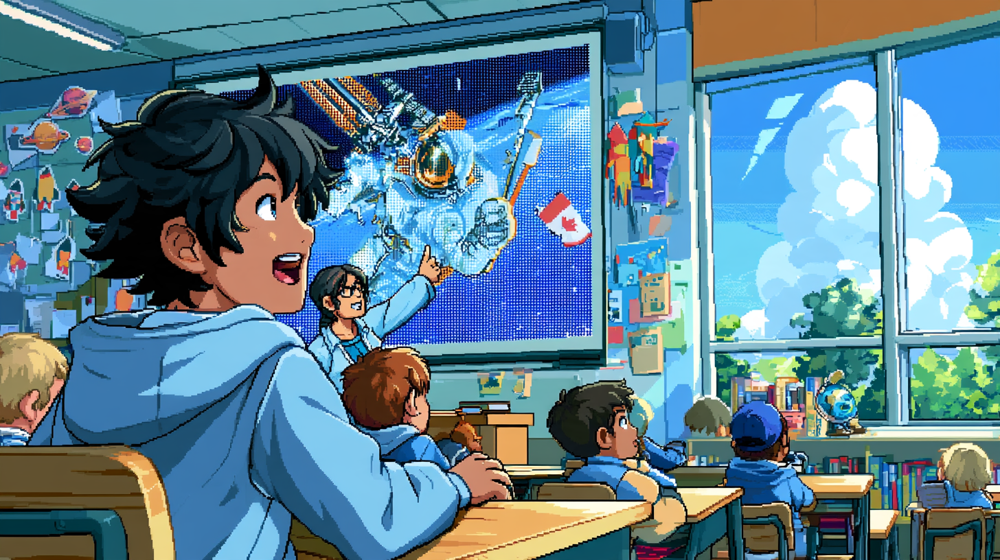
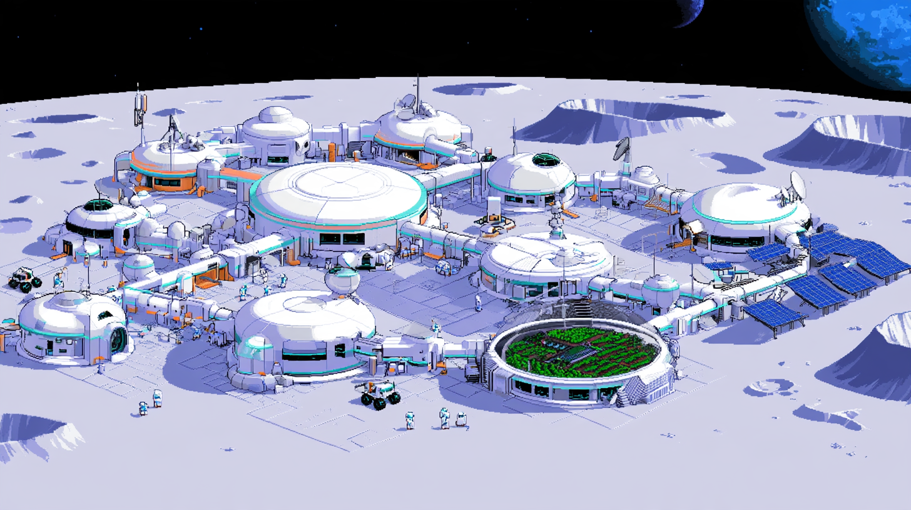
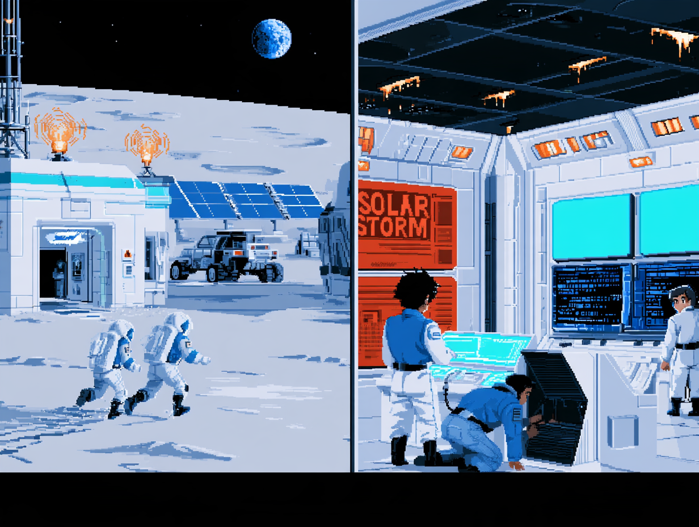
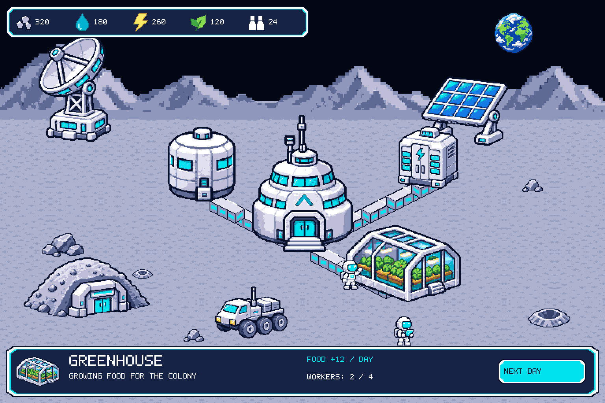

# AI use log — Mapmakers of the Moon

Space Apps 2026, Junior Astronaut Mission Trainer. Kept beside the 25-hour board (`Mapmakers 25-Hour Board.html`).

**This is the merged master log.** It combines three records:

| Tag | Source | What it gave |
|---|---|---|
| **[R]** | Repository evidence (git, file times, hashes, reports) | Facts that can be checked |
| **[X]** | Codex-reconciled log (Nov 14) | Code and doc entries, SHA-256 matches, credit fixes |
| **[G]** | ChatGPT-chat log, `AI_USAGE_LOG.md` (dated Nov 15) | Pre-event planning, UI guide, art brief, asset pack method |
| **[T]** | Team message, Nov 14 | Midjourney prompts, "all art is AI" statement |

Times are America/Toronto. Commit times are checkpoints. File times are copy or export times. Neither is a prompt or generation time.
Anything not recorded is marked **not recorded** or **To confirm**. Test results are quoted from old reports and were not rerun.

> **Team statement (Nov 14): all project-created art is AI-created.**
> This covers image-model art, its derivatives, procedural graphics from AI-written scripts, and code-drawn placeholders.
> Python or Unity rendering is a method, not an image model. Engine, template, package and NASA/CSA data keep their own credits.

---

## 0. Big picture

- **Game = AI-written code + AI-made art + AI-assisted planning.** People gave direction, references and decisions.
- **Three tool families:**
  - ChatGPT: early planning, UI guide, art brief, cutscene prompt text, asset pack images.
  - Claude Code and Codex: code, tests, data, docs.
  - Midjourney: 7 cutscene images.
- **In the build today:** 7 Midjourney cutscenes, code-drawn 12×12 icons and greybox shapes.
- **Not in the build yet:** the 142-sprite AstroCiv pack. It sits in `Art/`, outside the Unity project.
- **Gaps that block a full replay of the build:** exact times, model versions, full chat transcripts, Midjourney job IDs, the origin of the board and master prompt. See section 8.
- **Three review flags** for the submission rules (children, a real astronaut, a real university). See section 7.

---

## 1. How the game was made (pipeline)

| Step | Stage | Tool | Output | In build? |
|---|---|---|---|---|
| 1 | Character and idea research (Nov 9) | ChatGPT [G] | Character direction | No (ideas only) |
| 2 | Challenge framing and data plan (Nov 10) | ChatGPT [G] | Concept, data source list | Shaped the briefs |
| 3 | Story and chapters (Nov 11) | ChatGPT [G] | Tutorial, outpost, storm, Mars levels | Shaped `Story.json` |
| 4 | Build brief and research brief (Nov 14, ~09:42–10:00) | Not recorded. Likely ChatGPT or Claude | `CLAUDE.md`, master prompt, research brief | Drives all code |
| 5 | Simulation, data, tests (11:36) | Claude Code [R] | Pure C# sim, 6 fixtures, 53 tests | Yes |
| 6 | Balance, sources, session logic (12:21–12:23) | Codex [X] | `GameSession.cs`, balance report | Yes |
| 7 | Playable map and storm flow (12:50) | Claude Code [R] | Main scene, PlayMode tests | Yes |
| 8 | Tutorial and campaign (13:47) | Claude Code [R] | Boot to Blueprint flow, 57 tests | Yes |
| 9 | UI/UX guide (14:11) and art guide (14:30) | ChatGPT [G] | Two guides in `Agent Instructions/` | Reference |
| 10 | Cutscene prompts, then images (images saved 15:07–15:09) | AI-written prompts, Midjourney [T] | 7 PNGs | Yes |
| 11 | Redesign: scenes, 4 levels, grades, Free Build (18:02) | Claude Code [R] | Menu, Cutscene, Game, Results | Yes |
| 12 | Real-time spec for a cloud agent (18:08) | Codex [X] | Prompt file | Spec only |
| 13 | AstroCiv pixel pack (copied 19:41–19:42) | ChatGPT image tool + scripts [G] | 142 PNGs, 3 atlases | **No** |
| 14 | AI log, credits, disclosure (19:58 onward) | Codex [X], Claude Code | This log | Docs |

**Big-picture conclusion:** the chain from idea to code to art can be rebuilt in order. Steps 4 and 10 have the weakest records.

---

## 2. Merge notes: duplicates and conflicts

| # | Topic | What the sources said | Decision |
|---|---|---|---|
| 1 | Who made the asset pack | [X]: "built-in image generation", tool unnamed. [G]: made in the ChatGPT project chat | **ChatGPT built-in image generation.** Model version not recorded |
| 2 | Who ran step C5 (pause, balance) | First draft: Claude Code. [X]: Codex, per the board | **Codex**, as the board states |
| 3 | Master prompt and briefs | [X]: tool unknown. [G]: ChatGPT planned the idea, story and research briefs on Nov 10–11 | **Planning = ChatGPT. Final file author = To confirm** |
| 4 | Log date | [X]: Nov 14. [G]: Nov 15 | Both kept. Pack copy time is Nov 14 19:42, which fits [G]'s "Nov 14 to 15" |
| 5 | Pack checks | [X]: 142 PNGs match the manifest hashes. [G]: 743 checks passed | **Both true.** `validation_report.json` shows 142 exports, 743 checks, 0 failed, 256 socket pairs |
| 6 | Cutscene files | [X]: 7 byte matches to Unity files. [G]: 7 cutscenes planned | **Match.** Prompt-to-file link is weak (section 6a) |
| 7 | Guide location | [G]: "Library file". [R]: `Agent Instructions/` | Use the repo path |
| 8 | Missing classroom variant `dd730eda` | [X]: not found in `Art/cutscenes/` | Kept as a historical note only |
| 9 | Dates before the event | [G]: Nov 9–11 work. Board: hackathon days Nov 14–15 | Both kept. Flag in section 8 |
| 10 | Duplicate rows | Same Nov 14 asset work appeared in [X] section 4b and [G] rows | **Merged into one asset-pack entry (A-pack)** |
| 11 | Storm cutscene prompt | Prompt 06 asks for a command center and "no text". `storm.png` is a split screen with "SOLAR STORM" text | **Conflict.** `storm.png` came from another prompt version (section 6a) |

---

## 3. Master timeline

| Date, time | Evidence | Event | Tool |
|---|---|---|---|
| Nov 9 | [G] | Character inspiration search. Reference images not kept | ChatGPT |
| Nov 10 | [G] | Challenge framing, educational story, NASA data source list | ChatGPT |
| Nov 11 | [G] | Junior Astronaut Mission Trainer chosen. Chapters drafted: Ontario tutorial, later space levels | ChatGPT |
| Nov 14, 09:42 | [R] file time | `CLAUDE_CODE_MASTER_PROMPT.md` saved | To confirm |
| 10:00 | [R] | `CLAUDE.md`, `RESEARCH_AGENT_BRIEF.md` saved | To confirm |
| 11:02 | [R] | Claude Code rate-limit notice. Reset noted as 2:20 p.m. | Claude Code |
| 11:36 | [R] commit `e7a0318` | Simulation, data, planning | Claude Code |
| 12:21 | [R] commit `c69752b` | Pause, speed, retry | Codex |
| 12:23 | [R] commit `3bc617c` | Balance, sources, submission notes | Codex |
| 12:50 | [R] commit `92ee279` | Playable greybox and storm flow | Claude Code |
| 13:47 | [R] commit `18941eb` | Tutorial and campaign | Claude Code |
| 14:11 | [R] file time | CivVI UI/UX guide | ChatGPT [G] |
| 14:30 | [R] file time | Art creation guide | ChatGPT [G] |
| Nov 14, before 15:07 | [G][T] | Seven cutscenes planned. Prompts written. Style fixed after early images "did not look 16-bit" | ChatGPT, Midjourney |
| 15:07–15:09 | [R] file times | Seven Midjourney files saved | Midjourney |
| 16:27 | [R] | `astroCiv idea figure.png` saved | Not recorded |
| 18:02 | [R] commits `0134998`, `ccdf991` | Folder move. Scenes, 4 levels, grades, Free Build | Claude Code |
| 18:08 | [R] | Real-time prompt file saved | Codex |
| Nov 14 to 15 | [G] | Pack brief, image generation, script cleanup, validation | ChatGPT + scripts |
| 19:41–19:42 | [R] file times | Pack masters and previews copied into `Art/` | Not recorded |
| 19:58 | [R] | Briefs and README edited (AI log rules added) | Codex |
| Nov 14 to 15 | [X] | Codex log reconciliation (C12) | Codex |
| Nov 15 | [G] | ChatGPT-side AI log drafted | ChatGPT |

---

## 4. Tools

| Tool | Used for | Evidence |
|---|---|---|
| ChatGPT (model not recorded) | Planning, UI/UX guide, art guide, cutscene prompt text, asset pack images, first AI log | [G] log; `Agent Instructions/` guides |
| Claude Code (model per session To confirm) | Code, tests, fixtures, UI, docs, board run log | Git commits; `PROGRESS_REVIEW.md` |
| Codex | Execution pass, balance and source checks, real-time spec, log reconciliation | Board run log; [X] log |
| Midjourney (version not recorded) | 7 cutscene images | `Art/cutscenes/`; `ASSET_CREDITS.md`; [T] prompts |
| Python, Pillow, NumPy | Cleanup, palette, resize, atlas, validation | `Art/AstroCiv_Asset_Pack/Tools/`. **Not AI models** |

---

## 5. Code and text entries

| # | When | Tool | Purpose | Method | Output | Human check |
|---|---|---|---|---|---|---|
| C1 | Nov 9–11 | ChatGPT [G] | Idea, challenge framing, data plan, story drafts | Chat with team | Concept inputs to the briefs | Drafts. Science facts unverified |
| C2 | Nov 14, 09:42–10:00 | To confirm | Master prompt, build brief, research brief | Team direction, AI expansion | `Agent Instructions/` briefs | Team owns the story rules |
| C3 | 11:36 | Claude Code | Simulation, placement, loaders, story text, 6 fixtures | From briefs | `Scripts/Sim`, `Scripts/Data`, `Data/Resources` | 53 EditMode tests. No player test |
| C4 | 11:02 | Claude Code | Rate-limit stop at M2 | Noted in `PROGRESS_REVIEW.md` | n/a | Reset time not verified |
| C5 | 12:21–12:23 | Codex | Pause, speed, retry. Balance, source, submission checks | From briefs and settings | `GameSession.cs`, `BALANCE_REPORT.md`, `SCIENCE_SOURCES.md`, `SUBMISSION_REQUIREMENTS.md` | Automated and source checks. No human review recorded |
| C6 | 12:50 | Claude Code | Greybox map, controls, storm flow | Commit `92ee279` | Main scene, PlayMode tests | 55 tests. `mission-greybox.png` |
| C7 | Nov 14 (Codex pass) | Codex | Test plan, learning checks, scenarios, 141-row assumptions table, submission drafts | From existing bots and settings | `TEST_PLAN.md`, `PLAYER_LEARNING.md`, `SCENARIOS.md`, `SCIENCE_ASSUMPTIONS.csv`, `SUBMISSION_NOTES.md` | Drafts only |
| C8 | 13:47 | Claude Code | Tutorial and campaign sequence | Commit `18941eb` | `GAMEPLAY_SEQUENCE.md`, `campaign-tests.json` | 57 tests |
| C9 | 14:11–14:30 | ChatGPT [G] | CivVI UI/UX guide. Art creation guide | Team asked for one clean markdown file | Two guides | Team requested the single-file form |
| C10 | 18:02 | Claude Code | Redesign: 4 levels, grades, Next Day, Free Build, crew chat, Data and Credits screen, 7 cutscenes wired with watermark | Commits `0134998`, `ccdf991` | `Scripts/Game`, `Scripts/UI`, `Levels.json` | 55 EditMode + 3 PlayMode green. Human play-test pending |
| C11 | Nov 14, before C12 | Codex | Compare turn-based and real-time play | Read README, notes, mechanics | Advice only | Team chose real-time |
| C12 | 18:08 | Codex | Real-time and failure-scene spec for a cloud agent | Prompt written | `REALTIME_GAMEPLAY_CLOUD_AGENT_PROMPT.md` | Run status not recorded |
| C13 | Nov 14 | Initial draft (self-named Claude Code) | First AI log | From board and repo | Earlier `AI_USE_LOG.md` | Needed corrections |
| C14 | Nov 14 to 15 | Codex | Log reconciliation: hashes, credits, board AI tab, rules in briefs | Read board, git, art | This log (earlier version), `ASSET_CREDITS.md`, `SUBMISSION_NOTES.md` | No human approval or game test claimed |
| C15 | Nov 15 | ChatGPT [G] | Chat-side AI log | Written from visible chats | `AI_USAGE_LOG.md` (attachment) | Coverage note: not a full export |
| C16 | Nov 14 | Claude Code | **Merge of all logs. Saves Midjourney prompts. Checks hashes and images** | Read both logs, repo, 2 images | This file, `MIDJOURNEY_CUTSCENE_PROMPTS.md` | Team review needed |

**Notes**
- The board's "Reserved for Opus/team" is a plan. It does not prove an Opus model made anything.
- Uncommitted code changes are not credited to an agent.

---

## 6. Art

### 6a. Cutscenes — Midjourney

All seven are in the build, with a visible "AI-generated image" label.
Full prompts: [MIDJOURNEY_CUTSCENE_PROMPTS.md](MIDJOURNEY_CUTSCENE_PROMPTS.md). Prompt writer: AI. Tool not recorded.

| Scene | Image |
|---|---|
| 01 bedroom |  |
| 02 classroom |  |
| 03 graduation |  |
| 04 launch |  |
| 05 colony |  |
| 06 storm |  |
| 07 message |  |

**File, prompt and import chain**

| # | Prompt title | Unity file | Original filename starts with | Prompt match |
|---|---|---|---|---|
| 01 | Just One More Turn | `bedroom.png` | `Authentic_16_bit_pixel_art_JRPG_cutscene_cozy_chi…_2 (1)` | Loose. Word order differs |
| 02 | The Astronaut from Ontario | `classroom.png` | `Authentic_16_bit_JRPG_pixel_art_cutscene_in_a_che…_0` | Loose |
| 03 | Years of Learning | `graduation.png` | `Heartwarming_authentic_16_bit_pixel_art_RPG_cutsc…_1` | Loose |
| 04 | The Journey Begins | `launch.png` | `Epic_heartwarming_16_bit_pixel_art_space_adventur…_1` | Close |
| 05 | Welcome to Our New Home | `colony.png` | `Isometric_16_bit_pixel_art_lunar_colony_cutscene._…_1` | Loose |
| 06 | Our First Solar Storm | `storm.png` | `Dramatic_split_screen_cinematic_cutscene_authenti…_2` | **Mismatch.** Image is a split screen with "SOLAR STORM" text. Prompt asked for no text |
| 07 | A Message Back to Earth | `message.png` | `Heartwarming_16_bit_pixel_art_sci_fi_RPG_finale.__…_0` | Loose |

**What this shows**
- Midjourney file names should copy the start of the prompt. None matches the pasted text word for word.
- Likely cause: the files came from **earlier prompt versions**. The pasted set is "rewritten".
- `storm.png` is clearly from a different prompt. [G] mentions a "more dramatic" storm variant with shelter urgency.
- **Import is verified:** all 7 Unity files are byte-identical to the originals ([X] SHA-256, rechecked in C16).
- Generation order is unknown. Files were saved 15:07–15:09 within two minutes.
- `astroCiv idea figure.png` (16:27): AI-created per team. Generator and prompt not recorded.
- An unused classroom variant `dd730eda` is named in old credits. It is not in the folder now.

### 6b. AstroCiv pixel asset pack — ChatGPT images, then scripts

**Method** (from `GENERATION_NOTES.md` [R] and [G]):
1. Approved concept board = visual reference. UI/UX guide = interaction rules.
2. AI image tool made small groups of objects (10 masters). Not crops of the board.
3. Scripts cropped each object, removed halos and artifacts.
4. Scripts mapped a shared palette, resized with nearest-neighbour, built sheets and atlases.
5. Scripts drew exact UI, corridors, font, shadows, dust masks.
6. Checks ran in code. Contact sheets and scene previews were looked at.

| Step | Count |
|---|---|
| Image-model masters (P1–P10) | 10 |
| Exported PNGs | 142 |
| Packed atlases | 3 |
| Validation checks passed | 743 of 743 |
| Corridor socket pairs checked | 256 |

| # | Master | Asked for | Becomes |
|---|---|---|---|
| P1 | `architecture.png` | Hub, habitat, greenhouse. A rerun removed attached modules | 3 buildings |
| P2 | `equipment.png` | Battery, dish, solar array | 3 buildings |
| P3 | `shelter_airlock_rover.png` | Shelter, airlock, six-wheel rover | 3 items |
| P4 | `functional.png` | Lab, life support, garage | 3 buildings |
| P5 | `astronaut_poses.png` | Idle, walk, wave, tablet, repair | Astronaut frames |
| P6 | `astronaut_walk.png` | 4 directions × 4 phases | 16 walk frames, 32×48 |
| P7 | `terrain_props.png` | Craters and rocks, 3 sizes | Moon props. Mars by palette change |
| P8 | `backdrops_ground.png` | Lunar ridge, Mars ridge, regolith | Backdrops, tiling ground |
| P9 | `earth.png` | Stylised Earth | 64×64 sprite |
| P10 | `corridor_source.png` | Two tubes | Design source only |
| P11 | `approved_reference.png` | Not recorded | Reference only. Not counted as P1–P10 |

**Made by scripts (not image-model output):** UI borders, 14 icons, bitmap font, decals, shadows, dust masks, corridor pieces, thumbnails. All are AI-created art by the team statement.

**Previews**

| Buildings | Moon scene | Mars scene |
|---|---|---|
|  |  |  |

| Astronaut | Icons |
|---|---|
|  |  |

**Pack limits** (from `validation_report.json`)
- Never run in Unity. Importer, placement, sorting and animation are untested.
- Not a pixel copy of the reference. Same style family only.
- Mirrored ground can look repeated on large maps.
- Font: A–Z, digits, a few symbols.
- **Not in `26NASAChallenge/Assets`.** Confirmed by folder listing.

### 6c. Code-drawn art

| Item | Where | Method |
|---|---|---|
| 12×12 building, resource, lock, star icons | `Scripts/UI/UIKit.cs` | AI-written code |
| Map shapes | `Scripts/UI` map code | AI-written code |
| Moon-base picture on the board | `Mapmakers 25-Hour Board.html` | Inline canvas, AI-written code |
| Unity welcome image, packages | Engine/template | Not team art. Own credit |

---

## 7. Review flags (rules and honesty)

| # | Flag | Evidence | Rule | Action |
|---|---|---|---|---|
| 1 | **Children shown** | Prompts 01–02 ask for an 11-year-old. Classroom image shows several children | Guide p. 13: no under-18 likeness | Team decision. Replace or justify |
| 2 | **Real astronaut asked for** | Prompt 02: "projected portrait of Canadian astronaut Chris Hadfield". Image shows a suited astronaut with a flag, face hidden by a visor | Brief: names only, no portraits | Check the image. Reword the prompt if rerun |
| 3 | **Real university and landmark** | Prompt 03 names University of Toronto St. George and University College | Brief: no real organizations unless verified | Verify or make generic. Check no logo |
| 4 | **Real place names** | Prompts 01, 07 name Mississauga | Story keeps this as setting | Fine if the board keeps it. Confirm |
| 5 | **Text in storm image** | `storm.png` shows "SOLAR STORM" | Prompt said no text | Cosmetic. Match to prompt or note |
| 6 | **Label on pack art** | Pack is AI-made | Guide p. 9: visible AI label | Add when imported |

---

## 8. What is missing (can the build be fully recovered?)

**Answer: mostly yes for what was built and in what order. Not yet for who typed what, when, and with which model.**

| # | Missing | Why it matters | How to fill |
|---|---|---|---|
| 1 | Chat transcripts: ChatGPT (Nov 9–15), Claude Code sessions, Codex sessions | Real prompts, edits, rejected output | Export chats. Save links here |
| 2 | Model names and versions, all tools | Disclosure accuracy | Read from each tool's history |
| 3 | Author of the master prompt, build brief, research brief, board HTML (Nov 14, 09:42–10:00) | Start of the whole chain | Team recall or chat history |
| 4 | Midjourney job IDs, run times, rerolls, discarded images | Prompt-to-file proof | Midjourney history page |
| 5 | Prompt versions that produced the 7 files (section 6a) | Pasted prompts do not match file names | Check Midjourney history |
| 6 | The early images that "did not look 16-bit" | Part of the art story. Tool unknown | Find in ChatGPT chat |
| 7 | Prompts and references used for the 10 pack masters | Only a summary exists in `GENERATION_NOTES.md` | Export from the chat |
| 8 | Origin of `approved_reference.png` and the idea figure | Reference for the whole pack | Team recall |
| 9 | Whether the cloud agent ran the real-time prompt (C12) | Prompt does not prove a run | Check agent history |
| 10 | Human choices: which images were picked, edited, approved | Disclosure of human role | Team notes |
| 11 | Work before the event (Nov 9–11) | Board says hackathon days Nov 14–15 | Decide how to describe planning |
| 12 | Character reference images from Nov 9 | Provenance of the lead character look | Team recall |
| 13 | Per-file authorship of code | Only commits and the board give attribution | Accept as a limit |
| 14 | Human playtests | Tests are automated only | Run and log |

---

## 9. Open items

| # | Item | Status |
|---|---|---|
| 1 | Name asset pack tool version | Open (tool = ChatGPT image generation; version not recorded) |
| 2 | Midjourney job IDs and matching prompt versions | Open |
| 3 | Seven cutscene source files to Unity names | **Done** (byte match) |
| 4 | Children, Hadfield portrait, University of Toronto (section 7) | Team decision pending |
| 5 | Record whether cloud agent ran (C12) | Open |
| 6 | Wire pack into Unity and add the AI label | Open |
| 7 | Final human approval of AI statement | Open |
| 8 | Human check of every AI-written fact, number and source | Open |
| 9 | Export all chat transcripts (section 8, row 1) | Open |

---

## 10. Rules and entry template

**Rules**
- One row per AI session or generation. Add it the same day.
- Record tool, model, session or job ID, prompt link, method, output path, status, human check.
- Status words: created, imported, used in build, proposed, discarded.
- Keep failures and unused variants.
- Do not copy a commit or file time as a generation time.
- Do not claim approval or testing that did not happen.
- Update the board AI tab, `ASSET_CREDITS.md` and the disclosure with this log.
- The game has **no live AI**. Crew chat is scripted.

| # | Date, time + evidence | Tool, model, ID | Purpose | Prompt link, method | Output path, status | Human check, tests |
|---|---|---|---|---|---|---|
| | | | | | | |

---

## 11. Project-page disclosure (draft)

We used ChatGPT, Claude Code and OpenAI Codex for planning, game code, tests, source checks, documentation, story text and gameplay design. All project-created art is AI-created. Midjourney made the seven story illustrations. ChatGPT's image tool made the AstroCiv sprite masters. Scripts then cleaned them and produced extra sprites, icons, UI and fonts. The team gave direction and references. Per-session records are incomplete and are marked in the log. The game runs offline with scripted crew dialogue and no live AI. NASA and CSA data are credited separately. They are not claimed as AI-made and do not imply endorsement.

---

## 12. Evidence and checks

| Check | Result |
|---|---|
| 7 cutscene files vs originals, SHA-256 | All 7 match (C16 rerun) |
| Pack PNGs under `Assets/AstroCiv` | 142 |
| `validation_report.json` | 142 exports, 743 checks, 0 failed, 256 socket pairs |
| `AI_USAGE_LOG.md` on disk | Not found. Content merged from the attachment |
| Pack present in Unity project | No |
| Images viewed in C16 | `classroom.png`, `storm.png` |
| Not checked | Midjourney history, chat exports, Unity run, human play |

Files: [prompts](MIDJOURNEY_CUTSCENE_PROMPTS.md) · [generation notes](../Art/AstroCiv_Asset_Pack/GENERATION_NOTES.md) · [pack README](../Art/AstroCiv_Asset_Pack/README.md) · [asset credits](../26NASAChallenge/ASSET_CREDITS.md) · [submission notes](../26NASAChallenge/SUBMISSION_NOTES.md) · [real-time prompt](../Agent%20Instructions/REALTIME_GAMEPLAY_CLOUD_AGENT_PROMPT.md) · [progress review](PROGRESS_REVIEW.md)
